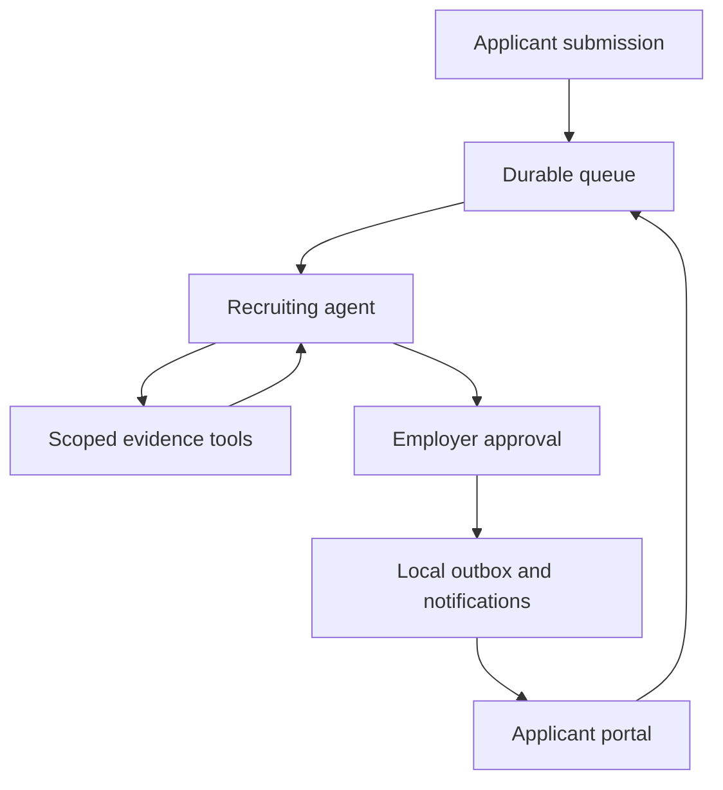

# AgentHire OS

**Inspectable recruiting agents with source evidence, durable execution and human approval.**

An individual applies without joining a company. A recruiting agent searches the
case, reviews saved job criteria and proposes clarification. The employer inspects
quotes before approving a question. A separate applicant assistant answers from
the published job and that applicant's own public status.

No paid model API, cloud account, domain or external email provider is required.
Initial dependency/model downloads need internet. Live inference uses your existing
CPU/GPU and memory; the default model download is about 2.5 GB.

## Try it locally

Requirements: Docker Desktop/Engine with Compose v2 and Python 3.12.

```sh
python -m scripts.local_demo --start --seed
```

The launcher creates generated secrets only if `.env` is missing, retains existing
volumes and adds a separate fictional company, **AgentHire Demo Lab**.

| Surface | Address |
| --- | --- |
| Company reviews, traces and approvals | http://localhost:8000/agent-center/ |
| Individual applicant account and public jobs | http://localhost:8000/portal/ |
| Recorded interactive replay, no sign-in | http://localhost:8000/demo/ |
| Captured local emails | http://localhost:8025 |
| Original Bright recruiting workspace | http://localhost:8000/workspace/ |
| API documentation | http://localhost:8000/docs |

Demo employer: `owner@agenthire.example.com`. Applicants:
`alex@agenthire.example.com`, `maya@agenthire.example.com`, `sam@agenthire.example.com`.
Local synthetic password: `AgentHire-Demo-2026!`.
The seeder refuses staging/production and never resets another account's password.

1. Open Agent Center, sign in as the demo employer and select AgentHire Demo Lab.
2. Inspect Alex's **Replay** run: Python/PostgreSQL evidence, unclear Docker experience.
3. Approve the proposed question, then inspect its delivery in Mailpit.
4. Sign in to Applicant Portal as Alex and answer with a Docker project example.
5. Inspect the fresh review; try the applicant assistant and a new individual application.

Replay is a deterministic fixture transport. It does not perform model inference
or establish live quality. The recorded demo is read-only. Original owner,
recruiter and viewer roles remain organization memberships; applicants are separate.

## Enable actual local inference

```sh
docker compose -f compose.yaml -f compose.agents.yaml --profile live-ai up -d --wait ollama
docker compose -f compose.yaml -f compose.agents.yaml exec ollama ollama pull qwen3:4b
```

Choose **Live local AI** before starting a new run. Old replay runs remain replay.
The model is configurable with `AGENTHIRE_AGENT_MODEL`; speed, compatibility and
quality must be evaluated for each model and hardware configuration. There is no
silent fallback to replay. Ollama cloud features and hosted graph tracing are disabled.

The model container has a 6 GiB memory cap; the database, API and workers require
additional memory. Smaller machines can use replay without starting Ollama.

## What makes it agentic?

The local model selects a JSON-schema-constrained tool, observes its result and
selects again. It can search criteria, inspect additional context, choose witnessed
evidence and submit a report. The applicant profile reads only allowed public
facts and selects a response topic. Server code validates scope and evidence and
renders the final summary/question; the model cannot invent email recipients.

- Recruiter tools: `get_job`, `search_resume`, `read_source`, `submit_review`.
- Applicant tools: `get_public_job`, `get_my_application`, `get_requested_information`, `respond_to_applicant`.

These are two bounded profiles sharing one runtime and local model. This project
does not claim a distributed autonomous team or automated hiring decisions.



## Engineering decisions

- FastAPI, SQLAlchemy, PostgreSQL/pgvector and a vanilla JavaScript Bright UI.
- Explicit public-job publication; internal job descriptions and criteria stay private.
- Verified individual accounts, applicant-only drafts, bounded PDF uploads,
  immutable submitted resumes and append-only clarification answers.
- LangGraph executes one decision/tool turn. A leased SQL worker persists the JSON
  checkpoint, event, counters and status together after each completed turn.
- Lease tokens fence stale writers. Cancellation wins over late inference; an
  interrupted model call may repeat after recovery.
- Step, reported-token, context and elapsed-inference budgets. Model identity is
  checked before/after requests and across checkpoints.
- Short evidence handles resolve to exact original quotes and Unicode offsets.
  Negation checks retain the surrounding source line, including when a model
  selects a narrower excerpt. Literal checks do not prove semantic entailment.
- Approval binds to a fingerprint of sources, job, criteria and application.
  Agents cannot hire, reject, browse, execute commands/SQL or send arbitrary mail.
- Transactional outbox, unique action keys and stable Message-IDs. SMTP is
  at-least-once; a crash after server acceptance may repeat delivery.
- Persistent per-user notifications, scoped failed-delivery retry, memory-only
  browser bearer tokens and no hosted tracing.

Read [architecture and tradeoffs](docs/local-agents.md),
[test walkthrough](docs/agents-testing.md), [verification scope](docs/agents-verification.md)
and the [Persian installation guide](docs/fa/INSTALL_AND_TEST_FA.md).

## Verify

```sh
uv sync --locked --no-install-project
uv run --locked --no-sync ruff check .
uv run --locked --no-sync pytest -q -W error
node --test tests/recruiter_ui.test.mjs tests/recruiter_notifications.test.mjs tests/recruiter_api_errors.test.mjs tests/recruiter_workflow.test.mjs tests/recruiter_design.test.mjs tests/agents_ui.test.mjs
uv run --locked --no-sync python -m scripts.agent_evaluation --mode replay
uv run --locked --no-sync python -m scripts.agents_smoke
```

The smoke test requires the seeded local stack and Mailpit. It creates a fictional
applicant and checks email verification, review, approval, reply, applicant assistant
and denied access to private company reports. SQLite domain tests do not establish
native PostgreSQL locking correctness.

For actual model evaluation inside the running local stack, retain separate reports:

```sh
python -m scripts.evaluate_agents --mode live --kind recruiter --repeat 1
python -m scripts.evaluate_agents --mode live --kind applicant --repeat 1
```

Reports record the model digest, runtime hash, hardware limits, tool errors, latency
and reported tokens. The recruiter corpus compares a fixed-query/top-five retrieval
baseline. A partial corpus, replay or substituted replay transport cannot earn full
live-quality acceptance. Synthetic results do not establish population-wide quality.

## Scope

This is a local portfolio environment. Mailpit captures messages; it does not relay
mail to real inboxes. Public deployment, production capacity, OCR, automatic calendar
booking and fully autonomous hiring are outside this version. Text-based PDFs and
three fictional resumes are supplied in `docs/demo-resumes/`.

Schema `0018_local_agents` adds tables/constraints without resetting existing data.
Stop the agent worker before using historical backup/recovery orchestration, which
does not manage the new service. Historical receipts remain historical; the previous
README is preserved in [development history](docs/history/README-before-agents.md).
