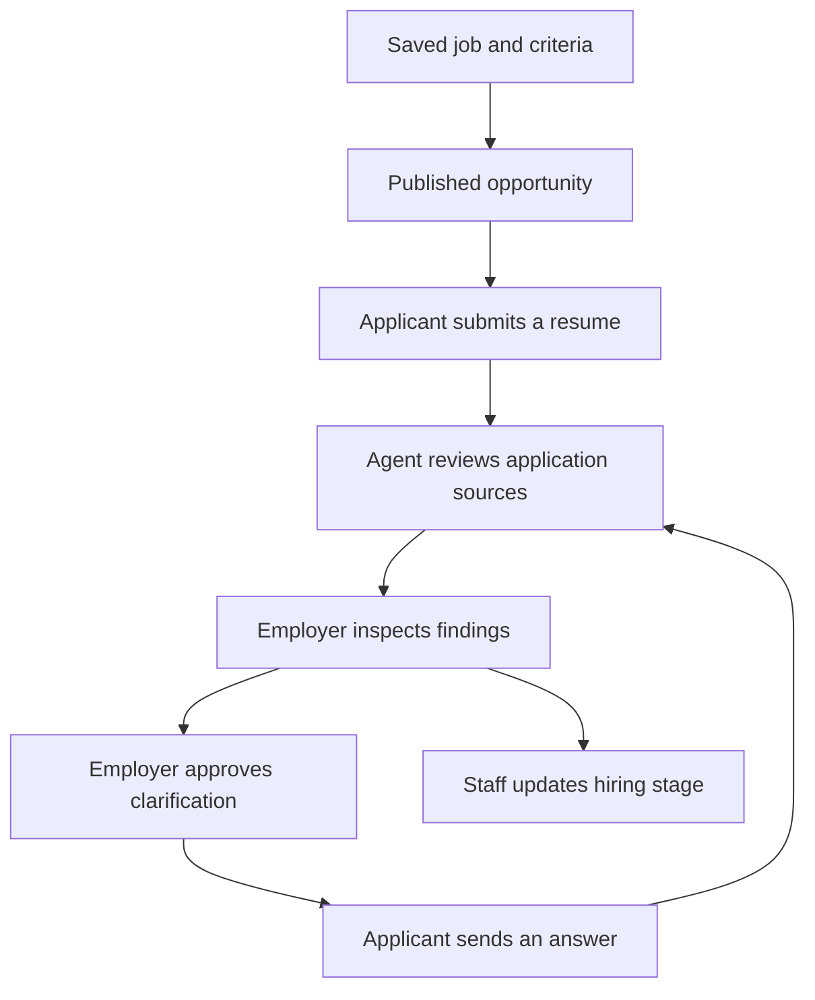

# AgentHire OS User Guide

This guide explains the current local portfolio platform through its actual
screens, controls and workflows. Start with [Installation](INSTALLATION.md) if
the services are not running. Commands belong in the repository root.

Use fictional accounts and resumes for the walkthrough. The sample names below
are test data. Addresses assume the default API port, 8000; replace that port if
your installation uses another one.

## Contents

- [How the platform works](#how-the-platform-works)
- [Choose the right screen](#choose-the-right-screen)
- [Understand accounts and permissions](#understand-accounts-and-permissions)
- [Try the seeded demo](#try-the-seeded-demo)
- [Create an organization and job](#create-an-organization-and-job)
- [Set the search query and criteria](#set-the-search-query-and-criteria)
- [Publish an opportunity](#publish-an-opportunity)
- [Apply through Applicant Portal](#apply-through-applicant-portal)
- [Review and approve an agent run](#review-and-approve-an-agent-run)
- [Change the hiring stage](#change-the-hiring-stage)
- [Manage resumes and processing](#manage-resumes-and-processing)
- [Search candidates and inspect evidence](#search-candidates-and-inspect-evidence)
- [Request a Grounded brief](#request-a-grounded-brief)
- [Manage members and sessions](#manage-members-and-sessions)
- [Read notifications and local email](#read-notifications-and-local-email)
- [Operate the platform](#operate-the-platform)
- [Troubleshooting](#troubleshooting)
- [Frequently asked questions](#frequently-asked-questions)
- [Glossary and further reading](#glossary-and-further-reading)

## How the platform works

An employer defines a job and the evidence to examine. A person applies through
the public portal. A recruiting agent searches that application's saved sources,
records findings and may propose a clarification. The employer inspects the
original quotations and approves or dismisses the proposal. An approved question
becomes visible to the applicant. Answering it queues a new review.



Hiring-stage changes are separate staff actions. Approving a review does not hire
or reject anybody. Search ranks, evidence counts and model findings help a person
inspect sources; they do not establish a candidate's competence.

There are two related ways to work:

- **Applicant workflow:** published opportunity, individual submission, agent
  review, human approval, clarification and public status updates.
- **Recruiter workspace:** organization records, manually managed candidates,
  PDF processing, candidate retrieval, criterion evidence and hiring stages.

The current Agent Center reviews individual portal submissions. Creating a
candidate or application manually in the recruiter workspace does not create an
applicant account or a portal submission.

## Choose the right screen

| Screen | Default address | Main purpose |
| --- | --- | --- |
| Recruiter workspace | http://localhost:8000/workspace/ | Create organizations/jobs, define criteria, manage candidates, PDFs, applications and access |
| Agent Center | http://localhost:8000/agent-center/ | Publish opportunities, start/inspect reviews, approve findings/questions and inspect local delivery |
| Applicant Portal | http://localhost:8000/portal/ | Register as an individual, verify email, apply, answer questions and ask the applicant assistant |
| Recorded demo | http://localhost:8000/demo/ | Inspect a fixed five-tool replay without signing in |
| Mailpit | http://localhost:8025 | Read captured local verification codes, receipts and approved questions |
| API documentation | http://localhost:8000/docs | Inspect the API contract and endpoints |

The recorded demo is a read-only presentation. Use Agent Center and Applicant
Portal for actions that save data. Each page keeps authentication in memory;
sign in again when opening another surface or reloading a page if requested.

## Understand accounts and permissions

A **user account** is the login identity. Organization roles are memberships of
that identity in a particular organization. A **candidate** is a recruiting
record; an **application** connects a candidate to a job. An individual portal
submission links the applicant's account to its company-side application.

| Role | Read company recruiting records | Change recruiting records, review and approve | Manage members, invitations and access events |
| --- | --- | --- | --- |
| Owner | Yes | Yes | Yes |
| Recruiter | Yes | Yes | No |
| Viewer | Yes | No | No |
| Individual applicant without membership | Own public application information only | Submit/answer their own applications | No |

An applicant can apply without creating or joining a company. A person can also
have organization memberships, but those are separate from applying.

The full member list and access-management controls are owner-only. A recruiter
or viewer seeing only their own role is expected behavior. Selecting a company
never grants access to a different company's records.

## Try the seeded demo

Follow the [demo installation steps](INSTALLATION.md#start-the-local-demo) first.
They add a fictional company, **AgentHire Demo Lab**, without resetting existing
accounts or data.

| Account | Email |
| --- | --- |
| Demo employer | `owner@agenthire.example.com` |
| Alex Morgan | `alex@agenthire.example.com` |
| Maya Chen | `maya@agenthire.example.com` |
| Sam Rivera | `sam@agenthire.example.com` |

The synthetic local password is `AgentHire-Demo-2026!`.

1. Open the recorded demo and select **Show next tool step** five times. Expect
   a Replay label, Python/PostgreSQL evidence and an unclear Docker finding.
2. Open Agent Center, sign in as the demo employer and choose **AgentHire Demo
   Lab** in **Company**. Keep **Execution mode** on **Replay demo — no model**.
3. In **Agent runs**, choose **Inspect run** for Alex. Wait for
   `waiting_approval`. Open the source excerpts and the **Tool timeline**.
4. Select **Approve & queue this question**. Expect the run to become
   `completed`, a question in Alex's portal and a captured email in Mailpit.
5. In a separate tab, sign in to Applicant Portal as Alex. Under **My
   applications**, answer the employer-approved question and select **Send
   answer**. A useful fictional answer is:

   ```text
   I built Docker images for Python services, maintained Dockerfiles and deployed containers in a test environment.
   ```

6. Return to Agent Center and inspect the new run. Its Docker evidence should
   reference the answer; the submitted resume itself remains unchanged.
7. In Alex's portal, select his application in **Applicant assistant**, ask
   `What is my application status?`, and select **Ask assistant**.

Maya's sample resume explicitly negates PostgreSQL experience, so the agent
should leave that criterion unclear. Sam's unrelated product-design resume
should leave all three criteria unclear. Unclear evidence is not a rejection.

Seeding is idempotent and does not reset a question that has already been
answered. For another first-time walkthrough, register a new fictional applicant
for the published job. The sample resumes are in [demo-resumes](demo-resumes/).

## Create an organization and job

Use this path for your own workflow, including an installation started without
demo data.

1. Open **Recruiter workspace**. Choose **New here? Create an account**, enter
   your email and a password of at least 15 characters, and create the account.
   Sign in with it if the page asks you to.
2. Open **Choose workspace**. Expand **Create organization**.
3. Enter an **Organization name**, such as `Example Hiring Lab`, and a unique
   **URL slug**, such as `example-hiring-lab`. A slug uses lowercase letters,
   digits and single hyphens between groups. Select **Create organization**.
4. Select the organization in the same context menu. Its creator is the owner.
5. Expand **Create job**, enter a **Title** and **Job description**, then select
   **Create draft**. Select the new job under **Current job**.
6. Open **Job setup**. Under **Edit job and publication status**, choose
   **Open** and select **Save job changes** when the role is ready to receive
   applications.

Expected result: the workspace shows the selected organization/job and permits
you to save its profiles. Candidate and application lists belong to that working
context. Use **Load latest job version** if another edit made your copy stale;
review the latest values before saving again.

Opening a job and publishing a public opportunity are separate operations.
Complete the next two sections before asking a new applicant to apply.

## Set the search query and criteria

In **Job setup**, expand **Edit criteria and search query**. This section holds
two different saved profiles.

### Candidate retrieval query

Enter the query used by **Retrieve using the job profile**, then select **Save
search**. For example, start with `Python` to check that your indexed sources
can be found, then try `Python PostgreSQL` for a more restrictive lexical query.

The search query is not a job description and is not an instruction to hire a
person. It is the input for job-based candidate retrieval. In lexical mode all
surviving terms must occur in the same chunk, so adding terms can reduce results.

### Individual criteria

Use **Add criterion** to create between one and ten criteria. Each has:

| Field | Meaning | Example |
| --- | --- | --- |
| Criterion label | Human-readable item to examine | PostgreSQL experience |
| Search terms | Query used to look for evidence of that criterion | `PostgreSQL` |
| Importance | Required or Preferred; describes the job requirement | Required |

For a first exercise, save separate criteria for Python, PostgreSQL and Docker.
Select **Save criteria** after editing the rows. Saving replaces the job's
current criterion list; it does not append another independent list.

The recruiting agent reads these saved criteria. Workspace criterion-evidence
checks also examine them separately. The general retrieval query does not
automatically create or update the criterion rows, and saving criteria does not
replace the separate retrieval query.

The UI displays profile versions. Changing criteria can invalidate a review
waiting for approval. Start a fresh review of the new inputs instead of trying
to approve an older result.

## Publish an opportunity

1. Open **Agent Center** and sign in with an owner or recruiter account.
2. Select the correct **Company**.
3. Under **Publish an opportunity**, select the **Saved job**.
4. Enter a **Public description** for applicants. Include the information you
   intend to make public, rather than internal notes or private evaluation rules.
5. Check **Published to applicants** and select **Save public job**.
6. Open Applicant Portal and find the job in **Public opportunities**.

The saved job must be **Open** to publish it. Both the open job status and the
publication flag are required for the public listing. A draft/closed job or an
unpublished opportunity will not be available for new applications.

Public descriptions are stored separately from internal job descriptions and
criteria. Saving the public text does not turn internal company reports into
public records. To withdraw the listing, clear **Published to applicants** and
save; to change the internal job status, use Job setup.

## Apply through Applicant Portal

1. Open Applicant Portal and select **Create an account**, or sign in to an
   existing individual account. No company membership is needed.
2. If email is unverified, select **Send verification code**.
3. Open Mailpit, locate the email addressed to that exact account, and enter
   its six-digit code under **Six-digit code**. Select **Verify email**.
4. In **Public opportunities**, select **Choose this opportunity** for the job
   you want. Check the selected job/company before submitting.
5. Under **Apply as an individual**, enter **Full name** and provide **Resume
   text**, a text-based PDF, or both as appropriate. The portal PDF limit is
   5 MiB. The supplied fictional PDF/text pairs are useful for practice.
6. Select **Execution mode**: start with Replay, or choose Live after completing
   [local-model setup](INSTALLATION.md#enable-live-agent-inference).
7. Select **Submit application**. Expect a receipt and a record in **My
   applications**. The company receives a submission and an agent review is queued.

For a PDF, allow time for extraction before expecting review findings. Scanned
image PDFs need OCR outside this version. The portal's verification, PDF upload
and final submission have separate failure states; inspect the displayed error
before retrying.

Submitted resumes are immutable in the portal. Clarification answers are saved
separately. Repeating submission for the same account/job does not create another
independent application. If the portal shows **Draft only**, choose the same job
and resubmit to finish that draft.

### Answer an employer-approved question

Under **My applications**, read **Employer-approved question**, enter **Your
clarification** and select **Send answer**. The answer is attached to the
particular approved question revision and queues a fresh employer review.
Choose the desired execution mode before sending the answer.

An unapproved agent proposal is not visible here. Refresh after a changed
question rather than answering an old revision. Hired and rejected applications
are terminal; further clarification is unavailable after the process is closed.

### Use the applicant assistant

Select a submitted record under **Your application**, enter a **Question**, and
select **Ask assistant**. Supported topics include the published job, your public
application status and approved clarification. For example:

```text
What is my application status?
```

The assistant uses that applicant's permitted public facts. Requests for another
applicant's records or private company reports receive a handoff to the employer.
Read the displayed execution mode and run status while waiting for an answer.

## Review and approve an agent run

1. In Agent Center, select **Company** and inspect the job title on the incoming
   application card.
2. Set **Execution mode** before selecting **Start review**. Submission and
   clarification can already have queued a run; inspect existing runs first.
3. Select **Inspect run** under **Agent runs**. Open **Tool timeline** events
   and source excerpts, and read the findings and proposed question.
4. At `waiting_approval`, decide whether the sources support the proposal.
   Select **Approve & queue this question**, **Approve reviewed findings** when
   there is no question, or **Dismiss**.
5. After approving a question, check the portal and Mailpit. After a reply,
   inspect the newly queued review rather than expecting the old run to change.

The agent can read the job, search the application's resume and answers, inspect
additional source context and submit a validated report. It cannot hire, reject,
run shell commands or choose an arbitrary email recipient.

| Run state | Meaning and next action |
| --- | --- |
| `queued` | Saved work is waiting for a worker; refresh or inspect its progress |
| `running` | A worker is processing tool/model turns; inspect the timeline |
| `waiting_approval` | Findings await an authorized person's approval or dismissal |
| `completed` | That run finished; approval is not a hiring-stage change |
| `failed` | Read the failure code, correct its cause and start a fresh review |
| `cancelled` | The run was cancelled or its proposal was dismissed |

Supported findings carry source quotations; unclear findings mean sufficient
support was not established. Read surrounding wording, especially negative
claims such as `No production experience with PostgreSQL`. A quotation is a
source claim, not independent verification that the claim is true.

### Execution mode

| Mode | What runs | When to use it |
| --- | --- | --- |
| Replay demo — no model | Deterministic fixture transport; no model inference or model tokens | Learn screens, exercise the synthetic workflow and diagnose integration |
| Live local AI — Ollama | The installed local agent model chooses tools and observes their results | Exercise actual inference and assess that model on your hardware |

Changing the selector affects new work. An existing replay run remains replay.
A successful live run exposes its observed model digest and reported model
tokens. A model/setup failure is explicit; there is no silent replay fallback.

### Approval, changes and cancellation

Approval is bound to the job, criteria, application and source versions used by
the review. `REVIEW_STALE` means these inputs are no longer valid for approval;
start a new review. `REVIEW_CHANGED` means refresh the currently displayed run.

For queued/running work, **Cancel run** saves a cancellation request. Late model
results cannot reactivate the run. At the approval stage, **Dismiss** cancels the
proposal. The current workflow allows at most five approved clarification
questions per submission; continue with human review after that limit.

## Change the hiring stage

Use **Recruiter workspace → Applications** with the correct organization and
job selected. Choose **Next status**, select **Update status**, then confirm the
candidate, job and transition shown in the dialog.

| Current status | Allowed next statuses | Usual public label for this status |
| --- | --- | --- |
| Applied | Screening, Rejected | Received |
| Screening | Interview, Rejected | Under review |
| Interview | Offer, Rejected | Interview stage |
| Offer | Hired, Rejected | Offer stage |
| Hired | None; terminal | Hired |
| Rejected | None; terminal | Not selected |

The last column describes the public label for the row's current status. An
outstanding approved question instead shows **Additional information requested**
until answered, except that terminal hired/rejected status takes precedence.
Linked portal applications receive public status notifications.

This workflow does not schedule an interview or send an offer contract.
Moving a record to Interview or Offer records the staff decision in the platform.

## Manage resumes and processing

### Add a candidate manually

In **Candidate review**, expand **Add candidate**, enter the person's details
and select **Create candidate**. Open the candidate dossier. **Overview** shows
the record, **Details** allows edits, **Resume** manages PDFs, and **Evidence**
shows criterion results. Metadata such as a professional summary does not by
itself create indexed PDF evidence.

To link the selected candidate to the selected job manually, use
**Applications → Apply selected candidate to this job**. This creates a
company-side application, not a portal login for the candidate.

### Prepare a PDF for workspace search

In the candidate's **Resume → PDF resumes** section:

1. Select a PDF and choose **Upload**. The current workspace browser uploader
   accepts PDFs up to 10 MiB; the individual portal has the separate 5 MiB limit.
2. Select **Start / retry extraction**. Use **Extraction status** until it
   reports Succeeded. Extraction obtains selectable text from the PDF.
3. Select **Build search chunks**. Chunking makes bounded pieces of the
   extracted text and preserves their original source positions.
4. For semantic search, select **Start / view embeddings**, then **Refresh
   embedding status** until Succeeded. This needs the enabled semantic feature,
   its model and embedding worker.
5. Return to **Evidence** or job-based retrieval and request fresh results.

Lexical search needs successful extraction and current chunks. Semantic search
additionally needs complete embeddings in the compatible model space. Enabling
a feature or downloading a model does not itself queue every document for it.

| Processing state | Meaning |
| --- | --- |
| Not requested | Start the corresponding operation when needed |
| Queued | Work is saved and waiting for its worker |
| Running | Processing is in progress |
| Succeeded | This operation completed; proceed to the next required step |
| Failed | Read the error, address it, then request a retry |

For download, select **Download PDF**. **Delete PDF** requires the exact
filename and removes the document's associated extraction/search data. Changing
source data invalidates affected results; reload evidence afterward.

Portal submission queues PDF extraction automatically. Agent review uses the
application's immutable resume/extracted text and clarification answers; it does
not require manually running the workspace's entire chunk/embedding workflow.

## Search candidates and inspect evidence

### Record search

Candidate, organization, job and application list searches filter their own
record fields. Candidate record search covers name, email, headline and location.
It is separate from searching the contents of a resume PDF. Lists are paged;
use **Next** and **Previous** and check the selected filters.

### Retrieve using the job profile

In **Candidate review**, expand **Retrieve using the job profile**. Select the
retrieval mode, optionally check **Only applicants for this job**, then select
**Retrieve**. The query comes from the job's saved **Candidate retrieval query**.

| Mode | Source of the ranking | Preparation |
| --- | --- | --- |
| Lexical | Literal normalized query terms in resume chunks | Extraction and current chunks |
| Semantic | Similarity from the local embedding model | Extraction, chunks and successful compatible embeddings |
| Hybrid | Combined lexical and semantic ranking | Semantic feature enabled; missing embeddings can leave an explicitly lexical-only result |

Without the applicants-only filter, retrieval can include other candidates in
the selected organization. The result uses a best source chunk per candidate,
rather than adding up scores from repeated resumes. Inspect the witness, source
coverage and model provenance. Ranking values from different modes are not
interchangeable percentages or hiring probabilities.

### Load criterion evidence

Select a candidate and job, open **Evidence**, and select **Load criterion
evidence**. Each saved criterion is checked separately against searchable sources.
Expand **View source evidence** and read the original text and its context.

| Source coverage | Meaning |
| --- | --- |
| No documents | No ready PDF source is available for this workspace evidence check |
| Sources have not been indexed yet | Prepare extraction and chunks |
| Some sources are ready | Only part of the available source set is searchable |
| Sources are searchable | The required source indexing is available |

**Required evidence: 2/3** means two required criteria have literal witnesses.
It does not certify that the candidate satisfies two requirements. A negative
sentence can contain the searched word, and missing evidence does not prove a
lack of skill. The agent's supported/unclear findings are a separate review layer.

## Request a Grounded brief

With a candidate and job selected, open **Evidence** and select **Grounded
brief**. The server assembles criterion evidence, requests bounded local-model
output when evidence is available, and validates citations before showing a brief.
Open **View source evidence** and **Response timing and model provenance**.

This feature requires its own enabled flag and local model; see
[optional retrieval and brief setup](INSTALLATION.md#enable-semantic-retrieval-and-grounded-briefs).
It is separate from an Agent Center review and does not approve a question or
change an application. With no evidence, a model call is not required and
`generator_used` can be false.

**Cancel wait** stops that page waiting for the response. A model thread already
running on the server can continue until it finishes. This differs from
**Cancel run** in Agent Center, which records cancellation of a durable agent run.

## Manage members and sessions

### Invite a recruiter or viewer

1. As an owner, select the organization and open **Members and access**.
2. Enter your **Current password to confirm access changes**.
3. Enter **Recipient email**, choose Recruiter or Viewer, then select **Create
   invitation** and confirm the action.
4. Copy the **Invitation code; shown only once** and provide it privately to
   the intended recipient. Creating this code does not imply external email delivery.
5. The recipient registers/signs in using that exact email, opens **Account
   security → Accept an organization invitation**, enters the code and selects
   **Accept invitation**. Refresh the organization list afterward.

Invitation codes are email-bound, expire and are single-use. Owners can revoke
an invitation, change a member's role or remove membership after password
confirmation. The final active owner cannot be removed or demoted. Invite as
recruiter/viewer first, then use an owner's **Change role** action if another
owner is needed. Applicants do not need these invitations to apply.

### Account security

Open **Account security and sessions** and choose **Load active sessions**.
Revoke a particular other session or **Revoke all other sessions** with current
password confirmation. To change a password, fill the new and confirmation fields
and select **Change password and revoke all sessions**; sign in again afterward.

Signing out revokes the current session. Closing or reloading a tab clears its
in-memory credentials but does not itself revoke the tracked server session.
An expired session requires a new sign-in. **Workspace guide**, accessible from
the question-mark button, also explains basic navigation and keyboard controls.

## Read notifications and local email

Agent Center and Applicant Portal have per-user **Notifications** sections.
Use **Mark read** on a notice. The recruiter workspace also has a notification
center. A notice and a captured email are different delivery surfaces.

Mailpit captures local messages at http://localhost:8025. Check the recipient
address when finding verification codes, receipts and clarification emails.
The project does not deliver these messages to Gmail or other real inboxes.

In Agent Center, **Local mail delivery** displays delivery state. Use **Retry
failed delivery** for failed messages after resolving the worker/Mailpit issue.
Email can be delivered more than once if a crash occurs after SMTP acceptance;
logical approval and answer retries are handled separately by the application.

## Operate the platform

Use the same Compose project name and configuration every time; the
[installation guide](INSTALLATION.md#keep-the-same-compose-project) explains why.

```sh
docker compose -f compose.yaml -f compose.agents.yaml ps -a
docker compose -f compose.yaml -f compose.agents.yaml logs --tail 80 api agent-worker extraction-worker mailpit
```

Expected core services are Healthy. The one-shot `migrate` service exits after
successful schema setup; `Exited (0)` is expected. Live/semantic features also
need their optional services and installed models.

Agent work persists in the database. After interruption, a worker can resume a
committed checkpoint when its lease becomes available. The default agent lease
is 240 seconds, so recovery is not necessarily immediate. The interrupted model
call can repeat. Refresh progress before creating another equivalent run.

For installation changes, retain the existing `.env` and named volumes. The
historical backup/recovery tools predate the agent worker; read
[local agent operation](local-agents.md#local-operation-and-honest-evaluation)
and [backups](backups.md) before using them on an agent-enabled stack.

## Troubleshooting

| Symptom or code | What to check and do |
| --- | --- |
| Company list is empty | Use an organization-member account; create an organization in Workspace or accept its invitation |
| Only my role is visible under access | Full member and invitation management is owner-only |
| Public job list is empty | Confirm internal job status Open, Published to applicants checked, and Save public job completed |
| `JOB_CRITERIA_REQUIRED` | Save the selected job's criteria in Job setup, then start a new review |
| `EMAIL_VERIFICATION_REQUIRED` | Request the code, read the correct recipient's Mailpit message, and verify in Portal |
| `VERIFICATION_INVALID` or `VERIFICATION_THROTTLED` | Use the latest valid code; wait before requesting another; check the account email |
| `MODEL_NOT_INSTALLED` / `MODEL_UNAVAILABLE` | Check Ollama, the configured agent model and the current project's model list |
| `EXPLANATION_MODEL_NOT_INSTALLED` | Install `qwen3:0.6b` for Grounded brief; the agent model is a separate feature |
| `EMBEDDING_MODEL_NOT_INSTALLED` | Install `qwen3-embedding:0.6b`, enable semantic retrieval and run its worker |
| PDF has no text, is encrypted or exceeds a limit | Supply an unencrypted text PDF within that uploader's limit; inspect extraction status |
| No resume search results | Check extraction, current chunks, saved query, filters and embedding coverage for the selected mode |
| `REVIEW_STALE` | Start a new review using the changed job, criteria, application and sources |
| `REVIEW_CHANGED` or `QUESTION_CHANGED` | Refresh the record and act on the current revision |
| `RECORD_CHANGED` / `RECORD_BUSY` | Load the latest record or wait; compare your draft before submitting again |
| `AUTH_BUSY` | Password work is at its per-process concurrency limit; wait and retry |
| Mail stays pending or failed | Check agent-worker and Mailpit, then use the scoped retry action for failed delivery |
| A button is disabled | Check selected context, role, required fields and whether an earlier request is pending |
| Application cannot advance | Check the permitted transitions; Hired and Rejected are terminal |

For a useful issue report, record the page, action, expected result, actual result
and safe error code. Use fictional data when sharing examples or screenshots.
Keep private configuration, credentials and real resumes out of public reports.

## Frequently asked questions

**Why keep the recruiter workspace if an agent reviews applications?**
It provides direct source inspection, candidate administration, search/indexing
controls and manual decisions. It also works on company-managed candidate records
that are not portal submissions. You do not have to repeat every processing step
for each successful portal review; use the workspace when you need those controls.

**Does the agent search the entire semantic candidate database?**
The current recruiting tools search the scoped application's saved resume,
extracted text and clarification answers. Workspace lexical/semantic/hybrid
retrieval is a separate feature for finding candidate evidence across eligible
company documents.

**Why are there three local model tags?**
They serve separate features. The default agent model is `qwen3:4b`; semantic
retrieval uses `qwen3-embedding:0.6b`; Grounded brief uses `qwen3:0.6b`. Recruiter
and applicant agent profiles share the configured agent model. Only install the
models for features you intend to use.

**Does Live mean paid cloud AI?**
It means inference through the configured local Ollama service. Initial downloads
need internet and inference uses your computer's resources. Replay runs without
model inference. CPU speed and available memory affect live latency.

**Why did an application become Completed but not Hired?**
Completed is an agent-run state. Hired is an application status chosen by staff
through Applications. These are separate state machines.

**Why can a source mention PostgreSQL but still be unclear?**
A literal mention can be negative or lack enough context. Inspect the quote.
The workspace's term-match counts and the agent's supported/unclear findings
answer different evidence questions; neither proves practical proficiency.

**Can the applicant see our internal criteria or proposed question before approval?**
The portal exposes the published job and the person's own public application
facts. Internal criteria/reports remain private, and a proposed question becomes
public to that applicant only after employer approval.

**Why are the sample application's next steps different on a second demo run?**
The seeder retains existing answers, approvals and application progress. Create a
new fictional applicant to repeat the first-submission path; restarting services
does not reset the existing company's records.

**Does changing the database or Compose project require another model download?**
Database and model data use separate volumes. A new Compose project normally gets
different named volumes and may not see the previous project's installed models.
Check `ollama list` for the selected project before downloading again.

**Can I use this as a publicly hosted hiring service immediately?**
This version is a local portfolio environment. Mailpit is local capture, OCR and
calendar booking are outside scope, and hosted operation/capacity need separate
acceptance. See [release acceptance](release-acceptance.md) for that boundary.

## Glossary and further reading

| Term | Meaning in this platform |
| --- | --- |
| Extraction | Reading selectable text from a stored PDF |
| Chunk | A bounded source-text slice with original positions |
| Embedding | A vector representation used for semantic retrieval |
| Criterion evidence | A source witness for a saved job criterion |
| Source fingerprint | Identity of the reviewed inputs used to reject stale approval |
| Tool timeline | Recorded agent tool choices, events and bounded results |
| Grounded brief | A validated summary attached to criterion evidence |
| Replay | A deterministic workflow transport with no model inference |
| Live | Actual local-model inference for newly created work |
| Lease/checkpoint | Worker ownership and saved progress used for recovery |

For deeper details, read [agent architecture](local-agents.md),
[recruiter UI behavior](recruiter-ui.md), [retrieval](retrieval.md),
[semantic retrieval](semantic.md), [grounded explanations](explanations.md),
[short agent walkthrough](agents-testing.md), [development](development.md)
and [operations runbook](operations-runbook.md).
